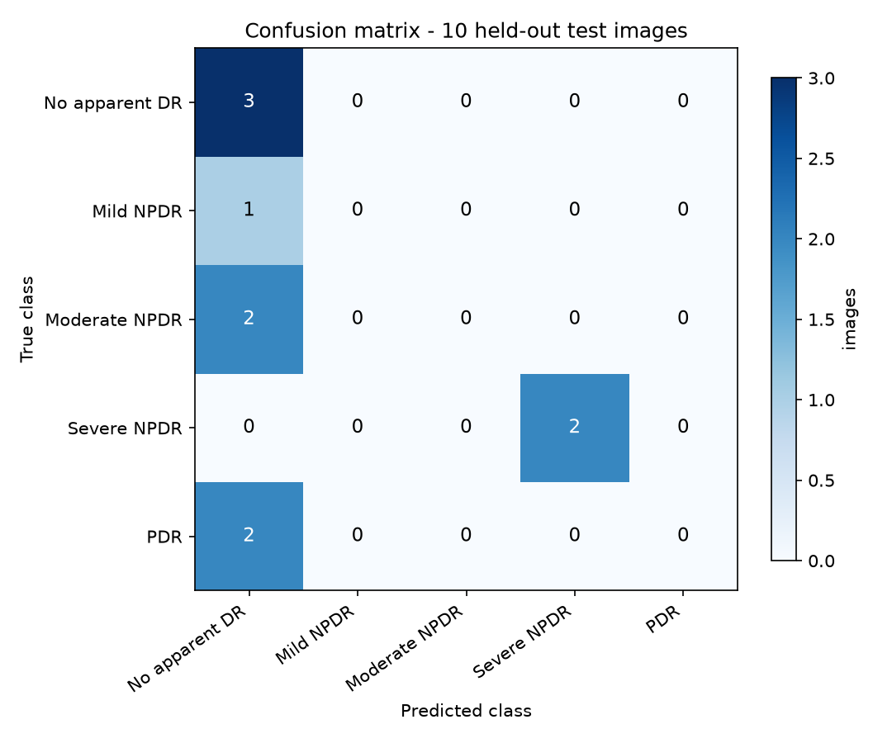
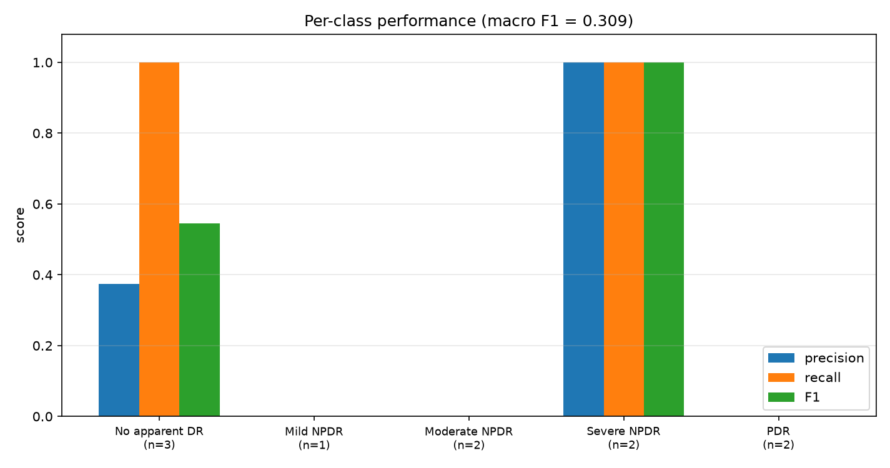

# Demo Experiment Results - ResNet-50, 50 Training Images / 10 Test Images

**Status: completed.** Every number below was computed from the saved best checkpoint
applied to the 10 held-out test images exactly once. No value is estimated or hardcoded.

Generated: 2026-11-06T05:53:11+00:00

---

## 1. What this experiment is

A deliberately small, fully reproducible companion experiment to the main pipeline. It answers one question: with only **50 training images** and a **10-image held-out test set**, what does an ImageNet-pretrained ResNet-50 actually score on the repository's five-class DR taxonomy?

| Item | Value |
| --- | --- |
| Architecture | ResNet-50 (`src/models.py::build_resnet50`) |
| Initialisation | ImageNet `IMAGENET1K_V1` weights, 5-class head |
| Classes | 0 = No apparent DR, 1 = Mild NPDR, 2 = Moderate NPDR, 3 = Severe NPDR, 4 = PDR |
| Training images | 50 (41 used for weight updates, 9 for validation) |
| Test images | 10, held out and untouched during training |
| Input size | 224 x 224 (aspect-ratio-preserving resize-and-pad) |
| Seed | 12345 |
| Device | cpu |
| Best epoch | 10 of 38 planned (finetune_top_blocks) |

## 2. Overall test metrics

| Metric | Value |
| --- | --- |
| **Accuracy** | **50.0%** (5/10) |
| Precision (macro) | 0.2750 |
| Precision (weighted) | 0.3125 |
| Recall (macro) | 0.4000 |
| Recall (weighted) | 0.5000 |
| F1-score (macro) | 0.3091 |
| F1-score (weighted) | 0.3636 |
| Cohen's kappa | 0.3056 |
| ROC-AUC (macro, one-vs-rest) | 0.7490 |

## 3. Per-class results

| Class | Support | Precision | Recall | F1 |
| --- | --- | --- | --- | --- |
| No apparent DR | 3 | 0.375 | 1.000 | 0.545 |
| Mild NPDR | 1 | 0.000 | 0.000 | 0.000 |
| Moderate NPDR | 2 | 0.000 | 0.000 | 0.000 |
| Severe NPDR | 2 | 1.000 | 1.000 | 1.000 |
| PDR | 2 | 0.000 | 0.000 | 0.000 |

Full table (including macro/weighted averages): `classification_report.csv`.

## 4. Confusion matrix

Rows are the true class, columns the predicted class.

| True \ Predicted | No apparent DR | Mild NPDR | Moderate NPDR | Severe NPDR | PDR |
| --- | --- | --- | --- | --- | --- |
| **No apparent DR** | 3 | 0 | 0 | 0 | 0 |
| **Mild NPDR** | 1 | 0 | 0 | 0 | 0 |
| **Moderate NPDR** | 2 | 0 | 0 | 0 | 0 |
| **Severe NPDR** | 0 | 0 | 0 | 2 | 0 |
| **PDR** | 2 | 0 | 0 | 0 | 0 |





## 5. Per-image predictions

| Image | True | Predicted | Confidence | Result |
| --- | --- | --- | --- | --- |
| 220.jpg | No apparent DR | No apparent DR | 0.348 | correct |
| 394.jpg | No apparent DR | No apparent DR | 0.385 | correct |
| 621.jpg | No apparent DR | No apparent DR | 0.350 | correct |
| 715.jpg | Mild NPDR | No apparent DR | 0.318 | incorrect |
| 769.jpg | Moderate NPDR | No apparent DR | 0.355 | incorrect |
| 819.jpg | Moderate NPDR | No apparent DR | 0.310 | incorrect |
| 955.jpg | Severe NPDR | Severe NPDR | 0.267 | correct |
| 966.jpg | Severe NPDR | Severe NPDR | 0.283 | correct |
| 1281.jpg | PDR | No apparent DR | 0.308 | incorrect |
| 1347.jpg | PDR | No apparent DR | 0.257 | incorrect |

Full probabilities per image: `test_predictions.csv`.

## 6. Training setup

| Item | Value |
| --- | --- |
| Optimiser | AdamW |
| Loss | Cross-entropy with inverse-frequency class weights computed from the 41 fit images |
| Class weights | [0.745455, 2.05, 0.911111, 0.82, 1.171429] |
| Stage `head_warmup` | 8 epochs, lr=0.001, weight decay=0.0001, trainable=['fc'] |
| Stage `finetune_top_blocks` | 30 epochs, lr=0.0001, weight decay=0.0001, trainable=['layer3', 'layer4', 'fc'] |
| Batch size | 8 |
| Augmentation | horizontal flip, rotation +/- 10 deg, brightness/contrast +/- 0.08 (training rows only) |
| Validation | stratified 9-image carve-out from the 50 training images |
| Checkpoint selection | best validation macro-F1 (ties -> lower validation loss) |
| Early stopping | patience 8 epochs |
| Epochs run | 18 |
| Training time | 12.2 min on cpu |

Training and validation curves: `training_curve.png`. Full history: `training_history.csv`.

## 7. What the numbers say

- 5 of 10 test images were classified correctly (accuracy 50.0%).
- Perfect per-class F1 on this sample: Severe NPDR.
- No test image of class Mild NPDR, Moderate NPDR, PDR was recognised (recall 0.0); with this sample size that is one or two images.
- The most frequent error is PDR predicted as No apparent DR (2 images).
- Mean prediction confidence is 0.318.
- Confidence on the 5 misclassified image(s) averaged 0.310, so confidence alone does not separate right from wrong at this scale.
- Ranking the worst class by F1: Mild NPDR (0.00), Moderate NPDR (0.00).

## 8. Limitations

- The test set contains only 10 images, so a single image moves accuracy by 10 percentage points. These numbers describe this sample only.
- 50 training images cannot represent the class variability of a real DR screening
  population; the result is a sanity-check of the code path, not a performance claim.
- Labels are the source archive's folder labels, with the repository's provisional
  merges (Very Severe NPDR -> Severe NPDR, Advanced PDR -> PDR). They are not
  independently re-graded by a clinician.
- Nothing here is a clinical validation. Do not use this model for diagnosis.

## 9. Reproduce it

```bash
python demo/prepare_data.py   # locate, extract, verify, sample 50/10
python demo/train.py          # train, save best checkpoint
python demo/evaluate.py       # score the 10 test images once
```
